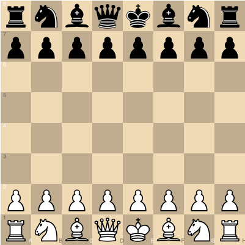

# @intermezzo-chess/chessground-react

[](https://github.com/intermezzo-chess/chessground-react/actions)
[](https://www.npmjs.com/package/@intermezzo-chess/chessground-react)
[](./LICENSE)

A strongly-typed, idiomatic React wrapper for [lichess.org's chessground](https://github.com/lichess-org/chessground) — the chess board that powers [lichess.org](https://lichess.org). Every field of chessground's `Config` and every method of its `Api` is exposed, with a design that stays faithful to chessground's own semantics rather than reinventing them.



- **Full coverage.** Every chessground `Config` field is a prop; every `Api` method is reachable through a `ref`. Nothing is left out.
- **Thin and faithful.** The core `<Chessground>` component is a 1:1 mirror of chessground — no invented chess logic, no surprises for anyone who already knows chessground's own docs.
- **Strongly typed.** Props and the imperative API reuse chessground's own exported types directly, so you never fight type drift between this wrapper and the library it wraps.
- **Optional chess.js integration.** A separate, clearly opt-in `useChessGame` hook (chess.js under the hood) for legal-move/check/checkmate convenience — entirely decoupled from the core wrapper.
- **Built with Vite**, ESM-only, ships bundled declaration files and a ready-to-use default theme.

## Install

```sh
npm install @intermezzo-chess/chessground-react @lichess-org/chessground react react-dom
```

`@lichess-org/chessground`, `react`, and `react-dom` are peer dependencies — install them alongside this package. If you want the optional chess.js integration (`@intermezzo-chess/chessground-react/chess-js`), also install `chess.js`:

```sh
npm install chess.js
```

## Quickstart

```tsx
import { Chessground } from '@intermezzo-chess/chessground-react';
import '@intermezzo-chess/chessground-react/style.css'; // required — see "Theming" below

function Board() {
  return (
    <Chessground style={{ width: 400, height: 400 }} movable={{ free: true, color: 'both' }} />
  );
}
```

That's a fully interactive, unrestricted board — drag any piece anywhere. Chessground itself has **no chess rules logic** ("no chess logic inside" is a deliberate design choice upstream), so anything past free-form piece movement — legal moves, check, checkmate — needs either your own rules engine or the optional `useChessGame` hook below.

## Free play vs. legal moves

```tsx
import { Chessground } from '@intermezzo-chess/chessground-react';
import { useChessGame } from '@intermezzo-chess/chessground-react/chess-js';

function LegalMovesBoard() {
  const game = useChessGame();

  return (
    <Chessground
      style={{ width: 400, height: 400 }}
      fen={game.fen}
      turnColor={game.turnColor}
      check={game.inCheck ? game.turnColor : false}
      movable={{
        color: game.turnColor,
        dests: game.dests,
        events: { after: (orig, dest) => game.move(orig, dest) },
      }}
    />
  );
}
```

`useChessGame` is a small, **standalone** hook built on [chess.js](https://github.com/jhlywa/chess.js) — it has no dependency on chessground at all. `game.dests` is a `Map<Key, Key[]>` that plugs directly into `movable.dests`. See [`useChessGame`](#usechessgame-optional) below for its full API, and the [demo app](#demo--storybook) for a runnable version plus ten other scenarios (premove, predrop, draw shapes, custom themes, and more).

## `<Chessground>` props

`ChessgroundProps` extends chessground's own `Config` directly — every field below is grouped exactly as chessground groups it. See [chessground's own README](https://github.com/lichess-org/chessground) for exhaustive semantics of each field; this table calls out what matters specifically for React usage.

| Prop                                                                                                                                                                                                                     | Type                                                                                                                    | Notes                                                                                                                                                   |
| ------------------------------------------------------------------------------------------------------------------------------------------------------------------------------------------------------------------------ | ----------------------------------------------------------------------------------------------------------------------- | ------------------------------------------------------------------------------------------------------------------------------------------------------- |
| `fen`                                                                                                                                                                                                                    | `FEN` (`string`)                                                                                                        | Board position. Unchanged values are never re-sent to chessground, so mid-drag/animation state is never interrupted by an unrelated re-render.          |
| `orientation`                                                                                                                                                                                                            | `'white' \| 'black'`                                                                                                    | Which side is at the bottom.                                                                                                                            |
| `turnColor`                                                                                                                                                                                                              | `'white' \| 'black'`                                                                                                    | Whose turn it is.                                                                                                                                       |
| `check`                                                                                                                                                                                                                  | `Color \| boolean`                                                                                                      | **Presence-sensitive**: omitting this prop entirely leaves chessground's existing check state untouched; passing it (including `false`) always applies. |
| `lastMove`                                                                                                                                                                                                               | `Key[]`                                                                                                                 | Highlights the last move's squares. A present-but-empty array explicitly unsets it; omitting the prop leaves the existing highlight alone.              |
| `selected`, `coordinates`, `coordinatesOnSquares`, `ranksPosition`, `autoCastle`, `disableContextMenu`, `addPieceZIndex`, `addDimensionsCssVarsTo`, `blockTouchScroll`, `touchIgnoreRadius`, `trustAllEvents`, `jsHover` | —                                                                                                                       | Passed straight through; see chessground's `Config` docs.                                                                                               |
| `viewOnly`                                                                                                                                                                                                               | `boolean`                                                                                                               | **Init-only** in chessground — see [Gotchas](#gotchas).                                                                                                 |
| `highlight`                                                                                                                                                                                                              | `{ lastMove?, check?, custom? }`                                                                                        | Highlight toggles + a `Map<Key, string>` of custom per-square CSS classes.                                                                              |
| `animation`                                                                                                                                                                                                              | `{ enabled?, duration? }`                                                                                               |                                                                                                                                                         |
| `movable`                                                                                                                                                                                                                | `{ free?, color?, dests?, showDests?, events?, rookCastle? }`                                                           | `dests` is always resent in full whenever anything else in this group changes (matches chessground's own wholesale-replace handling of `dests`).        |
| `premovable`                                                                                                                                                                                                             | `{ enabled?, showDests?, castle?, dests?, customDests?, additionalPremoveRequirements?, events? }`                      |                                                                                                                                                         |
| `predroppable`                                                                                                                                                                                                           | `{ enabled?, events? }`                                                                                                 |                                                                                                                                                         |
| `draggable`                                                                                                                                                                                                              | `{ enabled?, distance?, autoDistance?, showGhost?, deleteOnDropOff? }`                                                  |                                                                                                                                                         |
| `selectable`                                                                                                                                                                                                             | `{ enabled? }`                                                                                                          |                                                                                                                                                         |
| `events`                                                                                                                                                                                                                 | `{ change?, move?, dropNewPiece?, select?, insert? }`                                                                   | See [timing note](#imperative-api-ref) below — these fire asynchronously.                                                                               |
| `drawable`                                                                                                                                                                                                               | `{ enabled?, visible?, defaultSnapToValidMove?, eraseOnMovablePieceClick?, shapes?, autoShapes?, brushes?, onChange? }` | `visible` is **init-only** (see Gotchas); `autoShapes` is always resent in full alongside any other change in this group, same as `movable.dests`.      |
| `className`                                                                                                                                                                                                              | `string`                                                                                                                | Applied to the outer container `<div>` chessground mounts into.                                                                                         |
| `style`                                                                                                                                                                                                                  | `React.CSSProperties`                                                                                                   | Same container — this is how you size the board.                                                                                                        |
| `onReady`                                                                                                                                                                                                                | `(api: Api) => void`                                                                                                    | Fires once the `Api` exists, and again after any internal remount (see `viewOnly`/`drawable.visible` in Gotchas).                                       |

**Performance tip:** `movable.events`, `premovable.events`, and `predroppable.events` are diffed field-by-field (per callback), not by the identity of the wrapping `events` object — so a fresh inline `events: { after: fn }` literal each render (as in every example above) only triggers a re-sync when the callback itself is actually a new function. Wrap handlers passed into these groups with `useCallback` if you want the diffing to skip unrelated re-renders entirely; without it, chessground still ends up correct, just re-synced more often than strictly necessary.

## Imperative API (`ref`) {#imperative-api-ref}

```tsx
import { useRef } from 'react';
import { Chessground, type ChessgroundHandle } from '@intermezzo-chess/chessground-react';

const ref = useRef<ChessgroundHandle>(null);
<Chessground ref={ref} /* ... */ />;

// later:
ref.current?.api?.toggleOrientation();
ref.current?.api?.setShapes([{ orig: 'e2', dest: 'e4', brush: 'green' }]);
```

`ref.current.api` is the **raw, unmodified chessground `Api`** (`null` before mount / after unmount) — every method chessground itself exposes is available:

| Method                          | Signature                                                                                                                                                                         |
| ------------------------------- | --------------------------------------------------------------------------------------------------------------------------------------------------------------------------------- |
| `set`                           | `(config: Config) => void`                                                                                                                                                        |
| `state`                         | mutable `State` — read freely, but always mutate the board through the methods below, never by writing `state` fields directly (chessground won't re-render from a raw mutation). |
| `getFen`                        | `() => FEN` — pieces only, no move-count/castling flags.                                                                                                                          |
| `toggleOrientation`             | `() => void`                                                                                                                                                                      |
| `move`                          | `(orig: Key, dest: Key) => void`                                                                                                                                                  |
| `setPieces`                     | `(pieces: PiecesDiff) => void` — a `Map<Key, Piece \| undefined>`; `undefined` removes.                                                                                           |
| `selectSquare`                  | `(key: Key \| null, force?: boolean) => void`                                                                                                                                     |
| `newPiece`                      | `(piece: Piece, key: Key) => void`                                                                                                                                                |
| `playPremove` / `cancelPremove` | `() => boolean` / `() => void`                                                                                                                                                    |
| `playPredrop` / `cancelPredrop` | `(validate: (drop: Drop) => boolean) => boolean` / `() => void`                                                                                                                   |
| `cancelMove`                    | `() => void`                                                                                                                                                                      |
| `stop`                          | `() => void`                                                                                                                                                                      |
| `explode`                       | `(keys: Key[]) => void` — atomic-chess-style square explosion animation.                                                                                                          |
| `setShapes` / `setAutoShapes`   | `(shapes: DrawShape[]) => void`                                                                                                                                                   |
| `getKeyAtDomPos`                | `(pos: [number, number]) => Key \| undefined`                                                                                                                                     |
| `redrawAll`                     | `() => void`                                                                                                                                                                      |
| `dragNewPiece`                  | `(piece: Piece, event: MouchEvent, force?: boolean) => void`                                                                                                                      |
| `destroy`                       | `() => void` — handled automatically on unmount; you shouldn't normally need this yourself.                                                                                       |

**Timing note:** every callback in `Config.events` / `movable.events` / `premovable.events` / `predroppable.events` fires via chessground's own `setTimeout(fn, 1)` — genuinely asynchronous, never synchronously inline with the triggering pointer event. Don't assume ordering relative to code that runs immediately after e.g. `api.move()`.

## `useChessground` (headless)

`<Chessground>` itself is built on this hook — use it directly if you want to manage your own container element:

```tsx
import { useRef } from 'react';
import { useChessground } from '@intermezzo-chess/chessground-react';

function HeadlessBoard() {
  const containerRef = useRef<HTMLDivElement>(null);
  const api = useChessground(containerRef, { movable: { free: true, color: 'both' } });
  return <div ref={containerRef} style={{ width: 400, height: 400 }} />;
}
```

`useChessground(containerRef, props)` constructs the instance once the container is mounted, diffs and re-applies `props` on every subsequent render, and destroys the instance on unmount — it returns the live `Api` (or `null` before mount).

## `useChessGame` (optional)

Import from the separate `@intermezzo-chess/chessground-react/chess-js` entry point — nothing here pulls chess.js into your bundle unless you import this specifically.

```ts
import { useChessGame } from '@intermezzo-chess/chessground-react/chess-js';

const game = useChessGame({ fen: 'optional starting FEN', onMove: (fen) => console.log(fen) });
```

| Field                                                           | Type                                                                          | Description                                                                                                                                                                           |
| --------------------------------------------------------------- | ----------------------------------------------------------------------------- | ------------------------------------------------------------------------------------------------------------------------------------------------------------------------------------- |
| `fen`                                                           | `FEN`                                                                         | Current position.                                                                                                                                                                     |
| `turnColor`                                                     | `Color`                                                                       | Side to move.                                                                                                                                                                         |
| `dests`                                                         | `Dests`                                                                       | Legal destinations for the side to move — feed straight into `movable.dests`.                                                                                                         |
| `inCheck`, `isCheckmate`, `isStalemate`, `isDraw`, `isGameOver` | `boolean`                                                                     |                                                                                                                                                                                       |
| `move`                                                          | `(orig: Key, dest: Key, promotion?: 'q' \| 'r' \| 'b' \| 'n') => FEN \| null` | Returns the resulting FEN on success, `null` (state unchanged) if illegal. Defaults to queen promotion.                                                                               |
| `moveSan`                                                       | `(san: string) => FEN \| null`                                                | Same, but takes Standard Algebraic Notation (`"e4"`, `"Nf3"`, `"O-O"`, `"exd8=Q+"`) instead of coordinates — see [Keyboard-friendly move input](#keyboard-friendly-move-input) below. |
| `lastMove`                                                      | `[Key, Key] \| null`                                                          | The `[from, to]` of the most recent move (via either `move` or `moveSan`), or `null` before any move — feeds directly into chessground's `lastMove` prop.                             |
| `reset`                                                         | `() => void`                                                                  | Restores the configured starting `fen` (or the standard start position).                                                                                                              |
| `chess`                                                         | `Chess`                                                                       | Escape hatch to the underlying chess.js instance.                                                                                                                                     |

### Keyboard-friendly move input

Chessground itself has no notation parsing — it only understands literal square names (`api.move('e2', 'e4')`), never `"e4"`. `moveSan` closes that gap by handing the string to chess.js's own SAN parser:

```tsx
function MoveInput() {
  const game = useChessGame();
  const [value, setValue] = useState('');

  return (
    <form
      onSubmit={(e) => {
        e.preventDefault();
        if (game.moveSan(value) !== null) setValue('');
      }}
    >
      <input value={value} onChange={(e) => setValue(e.target.value)} placeholder="e4" />
      <button type="submit">Move</button>
    </form>
  );
}
```

A plain text `<input>` is fully keyboard-operable on its own — no mouse or drag required — which makes this a genuine alternative move-input path for anyone who can't use chessground's own pointer-driven drag/click interaction (chessground has no keyboard support at all: its event binding only listens for `mousedown`/`touchstart`, never `keydown`). This is **not** a claim that the board itself is now fully accessible — the visual grid still has no ARIA semantics, focus management, or keyboard navigation of its own — just that a working, screen-reader-and-keyboard-friendly way to make moves exists alongside it. See the demo's [Algebraic notation input example](./demo/standalone/src/examples/AlgebraicInput.tsx) for a complete version with error feedback.

## Theming

Chessground ships exactly three CSS files: structural CSS (`chessground.base.css`), a board theme (`chessground.brown.css`), and a piece theme (`chessground.cburnett.css`). This package bundles both combinations at two subpaths:

```ts
// Batteries-included: structural CSS + brown board + cburnett pieces
import '@intermezzo-chess/chessground-react/style.css';

// Structural CSS only — bring your own board/piece theme
import '@intermezzo-chess/chessground-react/base.css';
```

To bring your own theme with `base.css`, target chessground's own DOM/class conventions:

```css
.my-board cg-board {
  background-color: #eeeed2;
  /* ...your own board pattern... */
}
.my-board piece.pawn.white {
  background-image: url('/my-pawn-white.svg');
}
```

See the demo app's [Custom theme example](./demo/standalone/src/examples/CustomTheme.tsx) for a complete, running version of this pattern.

## Gotchas

- **`viewOnly` and `drawable.visible` are init-only inside chessground.** They control DOM/listener structure that's only built once, at construction — chessground itself won't react to changing them via `api.set()`. This wrapper detects a change and **destroys + reconstructs** the instance to make the prop change take effect (re-applying your current config to the fresh instance) — but this discards any in-flight interaction state (an active drag, a queued premove, a running animation), and fires `onReady` again. Prefer setting these once, at mount, when you can.
- **Don't wrap the board in animation/transform libraries** (framer-motion and similar) that want to control the container's own layout. Chessground computes pixel positions from the container's real, laid-out bounding box and fully owns its DOM subtree — a wrapper that also manipulates transforms/size on that subtree will fight it.
- **Chessground owns its container's children.** The `<div>` `<Chessground>` renders is handed to chessground once, on mount, and chessground replaces its contents (`element.innerHTML = ''` then builds its own tree) — never render your own children into it.
- **Callbacks are asynchronous** — see the [timing note](#imperative-api-ref) above.

## SSR

No special handling needed. Chessground is only ever constructed inside a `useLayoutEffect`/`useEffect` (isomorphic — falls back to `useEffect` when `window` is undefined), never during render, so this library has no `window`/`document` access on the server. Avoid reading browser-only state (e.g. `localStorage`) synchronously in whatever computes your own props, and you're fine.

## Demo & Storybook

- `npm run demo:standalone` — a Vite + React playground covering free play, legal moves, premove, predrop, draw shapes, view-only, custom theming, orientation flip, check highlighting, animation toggling, and the headless hook. Aliased directly to `src/`, so it hot-reloads against the library's source with no build step in between.
- `npm run demo:nextjs` — a real Next.js app that installs this package like any other consumer would (through the built `dist/` output and its `exports`/`sideEffects` fields, not aliased source). Exists to verify real-bundler behavior — in particular, that `style.css`'s import survives production tree-shaking under webpack, not just under this repo's own Vite-based tooling.
- `npm run storybook` — a lighter interactive reference for the core `<Chessground>` component's main configuration axes.

## Contributing

See [CONTRIBUTING.md](./CONTRIBUTING.md).

## License

[GPL-3.0-or-later](./LICENSE) — matching chessground's own license. Per chessground's README, a combined work built on it is expected to be distributed under the GPL too.
